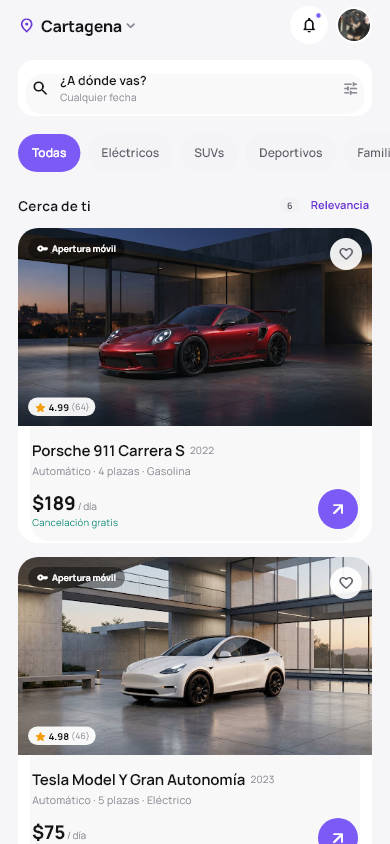

# CARMAN

Plataforma web y móvil para el alquiler de vehículos entre particulares, con llave digital, verificación de conductores y reservas protegidas.

## Descripción

Carman conecta a clientes, conductores y propietarios de vehículos. Permite explorar el catálogo, consultar disponibilidad, reservar, pagar, abrir el coche desde el móvil y gestionar viajes. El frontend está construido con Flutter (Android, iOS y web) sobre el design system de Carman.

## Tecnologías principales

- **Frontend:** Flutter 3.50+, Dart 3.14+, Riverpod y GoRouter.
- **Backend:** Node.js y NestJS.
- **Base de datos:** MySQL.
- **Autenticación y servicios complementarios:** Firebase.
- **Inteligencia artificial:** integración planificada.

## Estructura del proyecto

- `backend/`: API y lógica del servidor (NestJS).
- `frontend/`: aplicación Flutter para web y móvil. **Incluye 29 pantallas funcionales, paneles de cliente, propietario, conductor y administración, diseño responsive para móvil/tablet/web y datos demo.**
- `docs/`: documentación técnica.
- `infrastructure/`: configuraciones de infraestructura y despliegue.

## Frontend

```bash
cd frontend
flutter pub get
flutter run -d chrome
```

La aplicación arranca en modo demo, sin backend. Credenciales de prueba:

- Correo: `alex.rivera@carman.es`
- Contraseña: `Carman123`
- Código SMS: `582301`

Consulta la [documentación del frontend](frontend/readme.md) para arquitectura, flujo de pantallas, tests y guía de integración. El contrato JSON para backend está en [frontend/docs/api_contract.md](frontend/docs/api_contract.md).

### Vista previa



## Backend

El backend ya implementa autenticación con Firebase, registro por roles, perfil y gestión de vehículos. Los módulos de reservas, pagos, notificaciones, rutas y calificaciones exponen controladores vacíos que deben completarse antes de conectar el frontend en modo API.

```bash
cd backend
npm install
npm run start:dev
```

`CARMAN_USE_LIVE_API=true` y `CARMAN_API_URL=http://localhost:3000` activan el consumo de la API real desde Flutter.

## Estado

Frontend completo y navegable en modo demo. Backend en desarrollo: reservas, pagos y notificaciones pendientes. La integración en vivo está preparada a nivel de repositorios.
