# Carman · Frontend Flutter

Aplicación móvil y web del marketplace de alquiler de vehículos **Carman**, construida con Flutter y basada en el sistema de diseño `carman_design_system` / `carman_kinetic_mobility` de la carpeta `stitch_remix_of_carman_ui_design_system`.

La app implementa el flujo completo de cliente (descubrir → filtrar → detalle → checkout → reserva → llave digital), además de autenticación, verificación de licencia, pagos, viajes, favoritos, notificaciones y los paneles de **propietario, conductor y administración**.

| Welcome | Explorar | Detalle | Perfil |
| --- | --- | --- | --- |
| 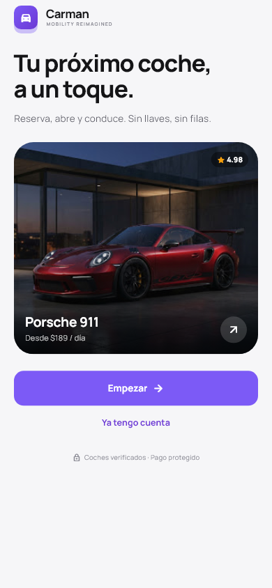 | 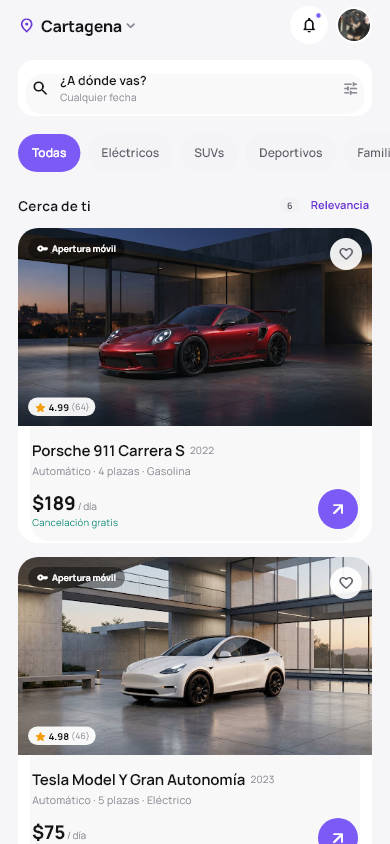 | 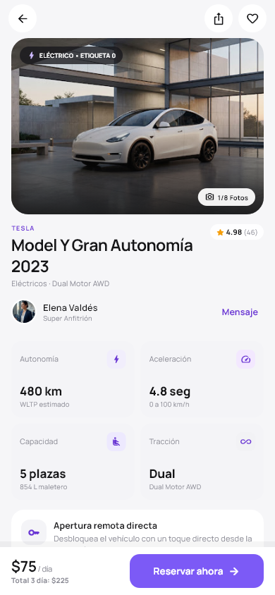 | 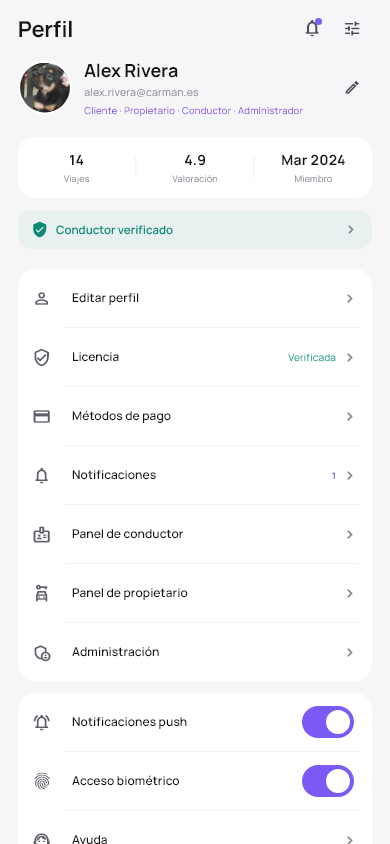 |

| Login | Búsqueda | Resultados |
| --- | --- | --- |
| 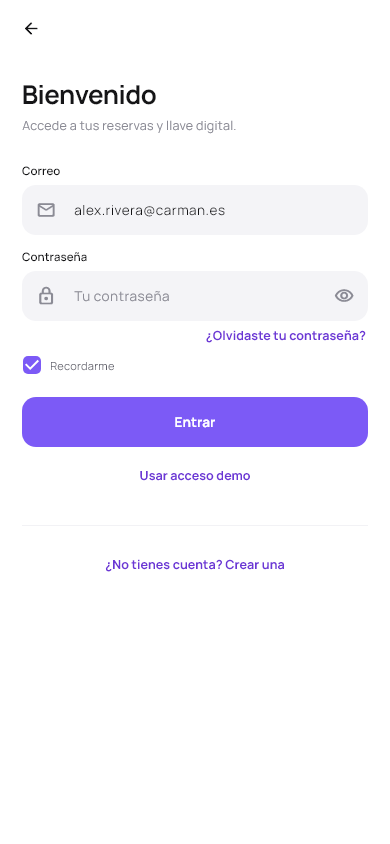 | 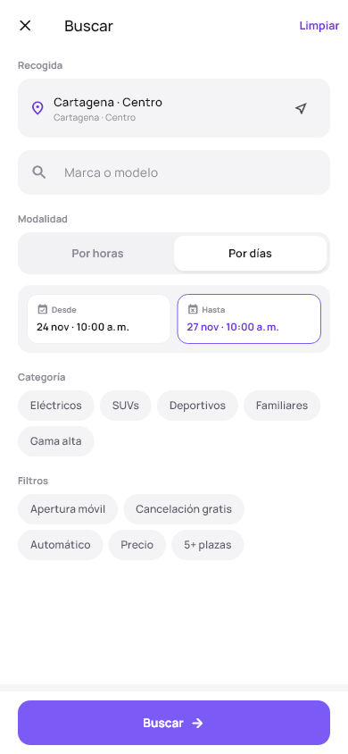 | 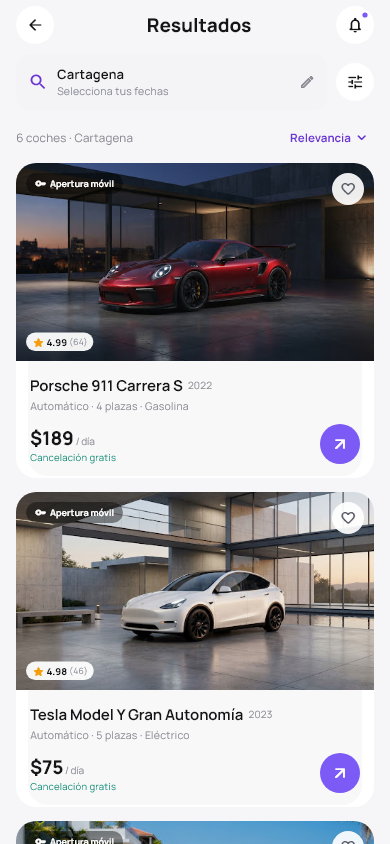 |

| Checkout | Pago | Viajes |
| --- | --- | --- |
| 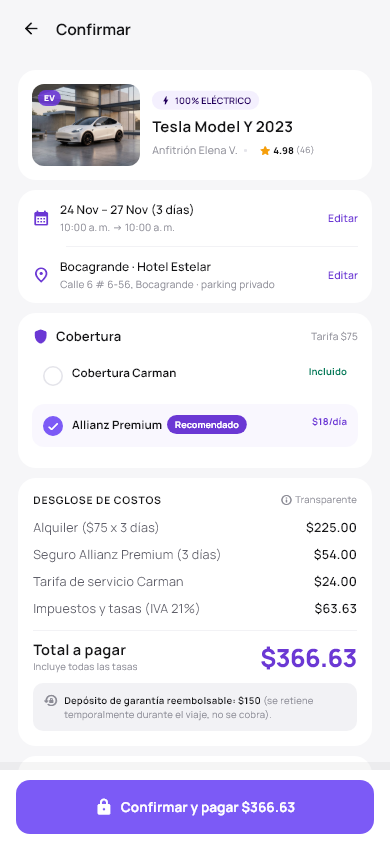 | 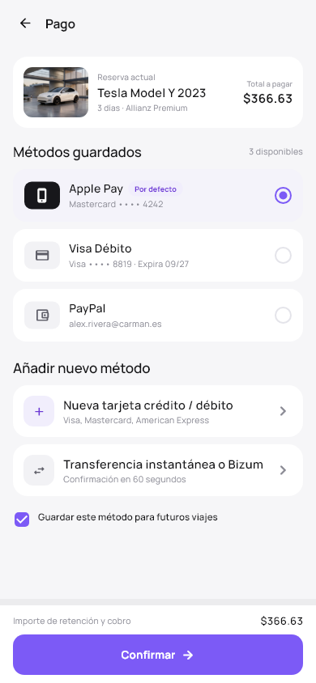 | 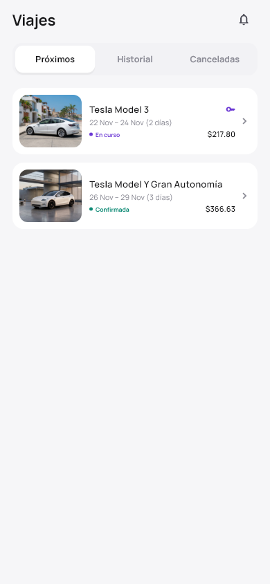 |

| Panel de propietario | Inicio web |
| --- | --- |
| 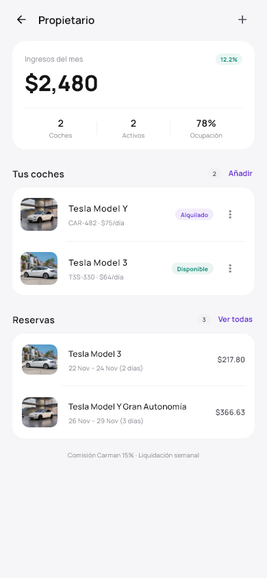 | 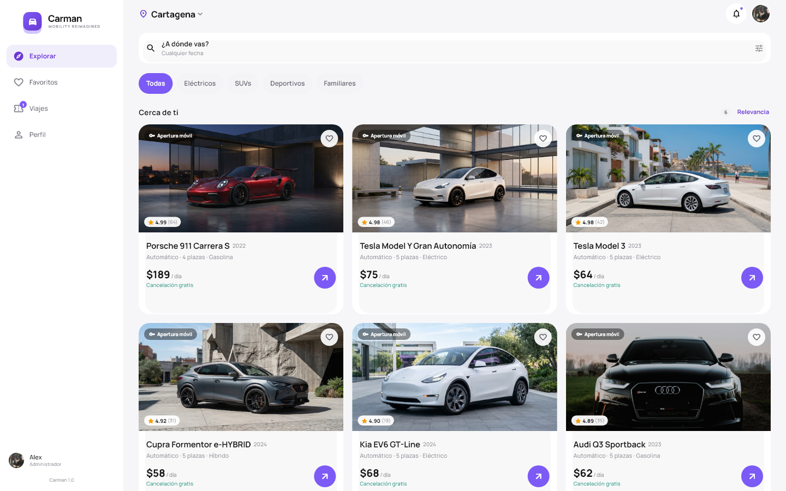 |

| Panel de conductor | Administración |
| --- | --- |
| 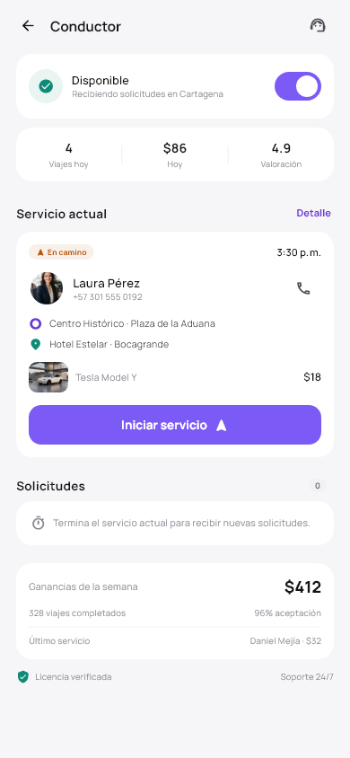 | 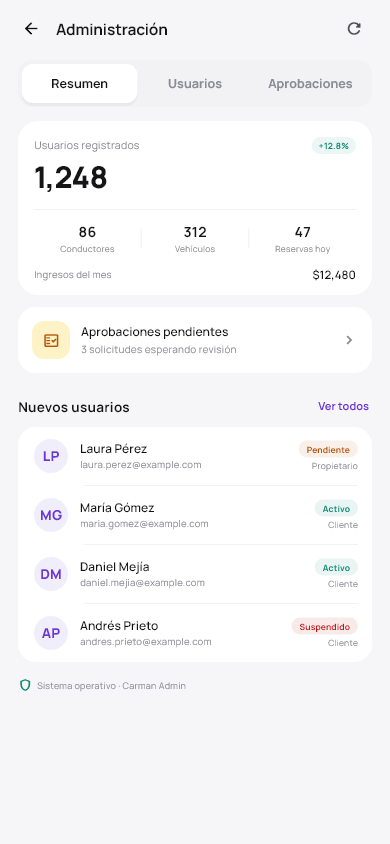 |

| Usuarios | Aprobaciones |
| --- | --- |
| 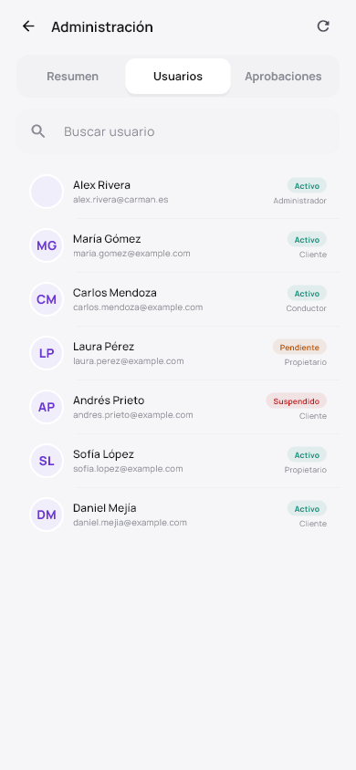 | 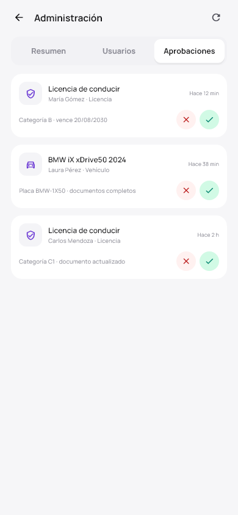 |

| Welcome web | Checkout web | Panel de propietario web |
| --- | --- | --- |
| 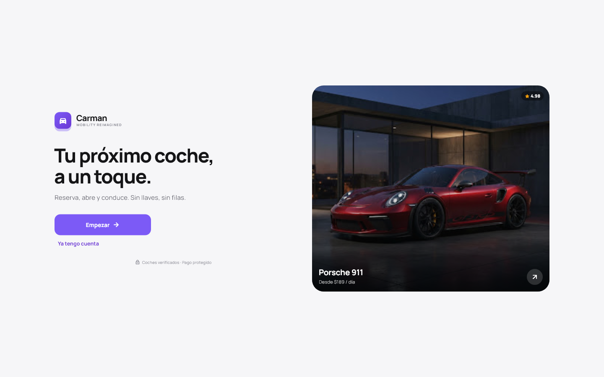 | 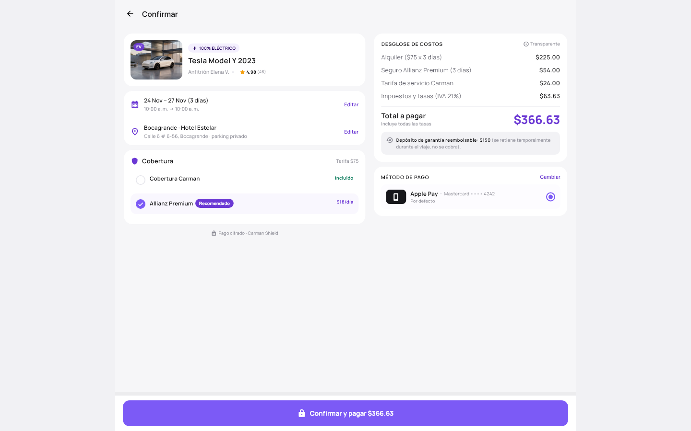 | 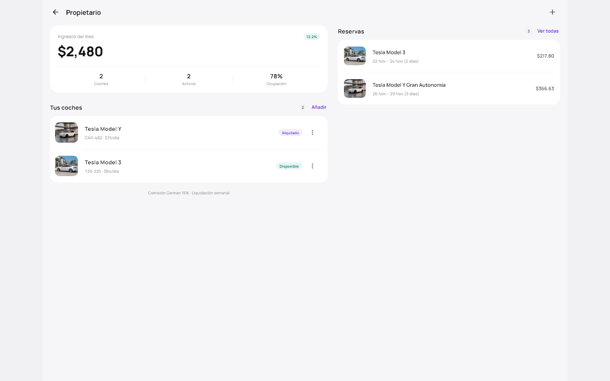 |

### Diseño responsive

| Rango | Navegación | Composición |
| --- | --- | --- |
| `< 720 px` | Bottom navigation | Una columna, tarjetas a sangre y formularios compactos |
| `720–1049 px` | Rail lateral compacto | Dos columnas en catálogo, viajes, favoritos y aprobaciones |
| `≥ 1050 px` | Sidebar expandido | Contenido hasta 1240 px, catálogo a 3 columnas, checkout y propietario a 2 columnas |

Las pantallas de detalle, pago, licencia, formularios y estados de reserva se centran con anchos de lectura de 560–1000 px. El contenido nunca se estira de borde a borde en escritorio.

La interfaz se ha simplificado intencionalmente: superficies planas, sin bordes duros, menos copy y un único acento violeta para las acciones. La composición es completamente responsive y mantiene la misma identidad en móvil, tablet y web.

---

## 1. Cómo ejecutar

Requisitos: Flutter **3.50+** y Dart 3.14+.

```bash
cd carman_/frontend
flutter pub get
flutter run -d chrome          # Web
flutter run                    # Android / iOS / escritorio
flutter build web --release    # Build web
```

La app arranca en modo **demo** con datos deterministas, por lo que todas las pantallas se pueden probar sin backend.

### Credenciales demo

| Campo | Valor |
| --- | --- |
| Correo | `alex.rivera@carman.es` |
| Contraseña | `Carman123` |
| Código OTP | `582301` |
| Tarjeta aprobada | `4242 4242 4242 4242` |
| Tarjeta rechazada | `4000 0000 0000 0002` |

> El enlace **Usar acceso demo** de la pantalla de login carga las credenciales automáticamente. La cuenta demo incluye los roles Cliente, Propietario, Conductor y Administrador; los paneles se abren desde **Perfil**.
> Las herramientas de demostración (pago rechazado, reserva expirada y licencia rechazada) están dentro de **Ajustes** en el perfil, para no ensuciar la pantalla principal.

---

## 2. Funcionalidades

### Autenticación y cuenta
- Bienvenida inmersiva con hero card y propuesta de valor.
- Login con validación, recordar dispositivo, acceso demo y biométrico simulado.
- Registro en 3 pasos con validación de mayoría de edad, fortaleza de contraseña, roles (cliente, conductor, propietario) y licencia.
- Recuperación y restablecimiento de contraseña con checklist de seguridad y reenvío con cuenta atrás.
- Verificación OTP de 6 dígitos con temporizador, reenvío y código demo.

### Explorar y reservar
- Home con ubicación por ciudad, búsqueda, categorías, ordenación y catálogo.
- Buscador con modalidad por horas/días, fechas, duración mínima, categoría, precio máximo, transmisión, plazas y filtros rápidos.
- Resultados con chips de filtros activos, ordenación y vista de mapa.
- Detalle con galería, anfitrión, especificaciones, comodidades, ubicación y barra de reserva sticky.
- Galería a pantalla completa con filtros, zoom, miniaturas y CTA de reserva.
- Favoritos persistidos localmente.
- Checkout con edición de fechas y punto de entrega, selección de seguro, desglose de costes, IVA 21%, depósito reembolsable y método de pago.
- Pago simulado con estados de éxito, rechazo bancario y expiración de la retención.
- Llave digital y código de reserva.

### Motor de precios (`PricingService`)
- Tarifa por horas (mínimo 2 h) y por días.
- Seguro básico incluido o **Allianz Premium** a 18 $/día.
- Tarifa de servicio Carman de 8 $/día (4 $/hora con mínimo de 6 $).
- IVA del 21 %, descuento semanal del 10 % desde 7 días y depósito de garantía de 150 $.
- Ejemplo validado en tests: 3 días de Tesla Model Y con seguro Premium = **$366.63**.

### Licencia y confianza
- Verificación con carga de frente/reverso desde cámara o galería (`image_picker`), guía de requisitos visuales, progreso de documentos y estados rechazado/en revisión/aprobado.
- La reserva queda bloqueada hasta tener la licencia aprobada.
- Aprobación automática de demo a los 15 s para poder recorrer el flujo completo.
- Notificaciones internas al enviar/aprobar la licencia.

### Viajes
- Próximos, historial y canceladas.
- Detalle con estado, llave digital, desglose de costes, cancelación con confirmación y reembolso, reseña con estrellas y factura simulada.

### Propietario
- Gate por rol: conversión desde cliente a propietario.
- Panel con ingresos, ocupación y estado de vehículos.
- Alta de vehículo con validación de placa/año/tarifas, cambio de estado (disponible/mantenimiento) y envío a revisión.

### Conductor
- Disponibilidad online/offline y modo “en servicio”.
- Servicio actual con cliente, recorrido, vehículo y acciones de iniciar/finalizar.
- Solicitudes nuevas con aceptar/rechazar.
- Resumen de viajes, ganancias, aceptación, valoración y documentos.
- Acceso desde el perfil y rol protegido; se puede activar el rol desde la cuenta si la licencia está aprobada.
- Repositorio demo/API y endpoints documentados para conectar con el backend.

### Administración
- Acceso restringido al rol administrador.
- Resumen de usuarios, conductores, vehículos, reservas e ingresos.
- Gestión de usuarios con búsqueda, detalle y suspensión/reactivación.
- Revisión de licencias y vehículos con aprobar/rechazar y actualización del contador de pendientes.
- Repositorio demo/API con rutas preparadas en `ApiEndpoints`.

### Perfil y preferencias
- Edición de datos, roles y verificación.
- Métodos de pago con alta de tarjeta (Luhn, vencimiento, CVV), selección por defecto y tarjeta de prueba con rechazo.
- Notificaciones con contador de no leídas, marcado como leídas y acciones.
- Ajustes, ayuda 24/7 y cierre de sesión.

---

## 3. Arquitectura

```
lib/
├── main.dart                     # bootstrap + SharedPreferences + locale es
├── app.dart                      # MaterialApp.router, tema, localizaciones, frame desktop
├── providers.dart                # composición de dependencias (Riverpod)
├── core/
│   ├── config/                   # configuración (API, demo, impuestos, ciudades)
│   ├── constants/                # registro de assets
│   ├── errors/                   # excepciones de dominio
│   ├── routing/                  # GoRouter + rutas + guard de sesión
│   ├── theme/                    # tokens, tipografía Manrope, sombras, radius
│   └── utils/                    # formateadores y validadores puros
├── data/
│   ├── local/session_store.dart  # sesión, favoritos y cuentas demo
│   ├── mock/mock_data.dart       # catálogo y estados de demostración
│   ├── models/                   # entidades y reglas de dominio
│   ├── remote/api_client.dart    # HTTP client con errores traducidos
│   ├── remote/api_endpoints.dart # contrato centralizado de rutas
│   ├── remote/api_mappers.dart   # mapeo defensivo JSON → modelos
│   └── repositories/             # interfaces + implementaciones demo/API
├── features/
│   ├── auth/                     # aplicación + 6 pantallas + password meter
│   ├── explore/                  # catálogo, búsqueda y resultados
│   ├── vehicle/                  # detalle, galería y mapa
│   ├── booking/                  # checkout, pagos y estados
│   ├── trips/                    # listado y detalle de reservas
│   ├── favorites/
│   ├── license/                  # verificación y revisión
│   ├── notifications/
│   ├── profile/                  # perfil, edición y notificaciones
│   ├── owner/                    # panel y alta de vehículo
│   ├── driver/                   # panel operativo del conductor
│   ├── admin/                    # resumen, usuarios y aprobaciones
│   └── shell/                    # bottom navigation con StatefulShellRoute
└── shared/widgets/               # design system reutilizable (botones, cards, campos…)
```

### Decisiones técnicas
- **Riverpod 3** (`Notifier`) para estado de aplicación, sin depender de `BuildContext`.
- **`material_ui` 1.11** como librería oficial de Material Design para Flutter 3.50 (migración completa desde `flutter/material.dart`).
- **Interfaz minimalista**: superficies planas sin bordes duros, jerarquía tipográfica compacta, un único acento violeta y copy reducido.
- **Responsive real**: móvil con bottom navigation y una columna; tablet con rail compacto y dos columnas; web con sidebar expandido, catálogo en tres columnas y checkout/dashboards a dos columnas. Las páginas transaccionales se centran con anchos legibles.
- **Movimiento discreto**: transiciones fade/slide de 170–260 ms, hover suave en tarjetas, entradas escalonadas en listas, tabs animadas y respeto a `MediaQuery.disableAnimations`.
- **GoRouter 18** con `StatefulShellRoute.indexedStack` para conservar el estado de cada tab y guard de autenticación basado en sesión.
- **Repository pattern**: `AuthRepository`, `VehicleRepository`, `BookingRepository`, `ProfileRepository`, `NotificationRepository` y `OwnerRepository`, con implementación demo e implementación API para conectar NestJS.
- **Modo dual demo/API**: `AppConfig.useLiveApi` selecciona la fuente de datos. Por defecto `false` para que la app sea presentable sin servidor.
- **Persistencia local** con `shared_preferences`: sesión, favoritos, ciudad, notificaciones leídas y cuenta registrada en demo. Para producción conviene migrar el token a `flutter_secure_storage`.
- **Sin claves externas**: mapa estilizado propio en lugar de Google Maps; cualquier API key se evita a propósito.
- **Responsive**: en pantallas > 720 px se muestra un marco de móvil centrado y una composición editorial de marca.
- **Accesibilidad**: tamaños táctiles mínimos, contraste, textos semánticos en botones principales y `SafeArea` en todas las pantallas.

---

## 4. Conexión con el backend NestJS (`carman_/backend`)

Para usar la API real:

```bash
flutter run \
  --dart-define=CARMAN_USE_LIVE_API=true \
  --dart-define=CARMAN_API_URL=http://localhost:3000
```

### Endpoints utilizados

Toda la capa API está implementada en el frontend y se activa con `CARMAN_USE_LIVE_API=true`. El contrato JSON completo —payloads, estados y ejemplos— está en [`docs/api_contract.md`](docs/api_contract.md).

| Método | Endpoint | Uso | Frontend | Backend |
| --- | --- | --- | --- | --- |
| POST | `/auth/login` | Login Firebase → idToken | Listo | Implementado |
| GET | `/personas/perfil` | Perfil autenticado | Listo | Implementado |
| POST | `/personas/registro` | Registro por roles | Listo | Implementado |
| PATCH | `/personas/perfil` | Editar perfil | Listo | Por completar |
| POST | `/personas/roles` | Añadir rol | Listo | Por completar |
| POST | `/personas/licencia` | Enviar licencia | Listo | Por completar |
| GET | `/vehiculos/catalogo` | Catálogo con filtros | Listo | **Pendiente** |
| GET | `/vehiculos/:id` | Detalle | Listo | Implementado |
| GET | `/vehiculos/mis-vehiculos` | Vehículos del propietario | Listo | Implementado |
| POST | `/vehiculos` | Publicar vehículo | Listo | Implementado |
| GET | `/reservas/mias` | Mis reservas | Listo | **Pendiente** |
| POST | `/reservas` | Crear reserva | Listo | **Pendiente** |
| PATCH | `/reservas/:id/cancelar` | Cancelar | Listo | **Pendiente** |
| POST | `/reservas/:id/calificacion` | Reseñar | Listo | **Pendiente** |
| GET | `/notificaciones` | Bandeja | Listo | **Pendiente** |
| PATCH | `/notificaciones/leidas` | Marcar leídas | Listo | **Pendiente** |
| GET | `/propietario/resumen` | Panel propietario | Listo | **Pendiente** |
| GET | `/conductor/resumen` | Panel conductor | Listo | **Pendiente** |
| PATCH | `/conductor/disponibilidad` | Disponibilidad | Listo | **Pendiente** |
| PATCH | `/conductor/servicios/:id/aceptar` | Aceptar servicio | Listo | **Pendiente** |
| PATCH | `/conductor/servicios/:id/iniciar` | Iniciar servicio | Listo | **Pendiente** |
| PATCH | `/conductor/servicios/:id/finalizar` | Finalizar servicio | Listo | **Pendiente** |
| PATCH | `/conductor/servicios/:id/rechazar` | Rechazar servicio | Listo | **Pendiente** |
| GET | `/admin/resumen` | Panel administrativo | Listo | **Pendiente** |
| GET | `/admin/usuarios` | Usuarios | Listo | Parcial (existe) |
| PATCH | `/admin/usuarios/:id/estado` | Suspender/reactivar | Listo | **Pendiente** |
| GET | `/admin/aprobaciones` | Aprobaciones | Listo | **Pendiente** |
| PATCH | `/admin/aprobaciones/:id` | Aprobar/rechazar | Listo | **Pendiente** |

Los repositorios API viven en `lib/data/repositories/api_*_repository.dart`; las rutas en `api_endpoints.dart` y los mapeos en `api_mappers.dart`. Así se puede ajustar el contrato sin tocar pantallas.

### Notas de integración
- El backend usa Firebase Admin; en modo API se espera `idToken` de Firebase y `Authorization: Bearer <token>`.
- `POST /personas/registro` exige que un propietario incluya al menos un vehículo y que conductores/propietarios aporten licencia. En el flujo demo el propietario puede añadir su coche después desde el panel; para producción se recomienda mover ese paso al registro o usar el endpoint de roles.
- El perfil real aún no devuelve el estado de licencia; el frontend asume aprobado para cuentas conductor/propietario y lo documenta en `ApiAuthRepository`.
- Para el catálogo real se propone `GET /vehiculos/catalogo` devolviendo `{ vehiculos: [...] }` con el contrato mapeado en `Vehicle.fromJson`.

---

## 5. Rutas principales

| Ruta | Pantalla |
| --- | --- |
| `/welcome` | Bienvenida / onboarding |
| `/login`, `/register` | Autenticación |
| `/forgot-password`, `/reset-password` | Recuperación |
| `/verify-otp` | Código SMS |
| `/home` | Explorar catálogo |
| `/home/results` | Resultados y filtros |
| `/search` | Buscador avanzado |
| `/vehicle/:id` | Detalle |
| `/gallery/:id` | Galería |
| `/map` | Mapa de resultados |
| `/checkout` | Confirmar reserva |
| `/payment-methods` | Métodos de pago |
| `/booking/success`, `/booking/failed`, `/booking/expired` | Estados de reserva |
| `/license`, `/license/review` | Verificación de licencia |
| `/favorites`, `/trips`, `/trip/:id`, `/profile` | Tabs y viajes |
| `/notifications` | Notificaciones |
| `/profile/edit` | Edición de perfil |
| `/owner`, `/owner/add-vehicle` | Panel de propietario |
| `/driver` | Panel de conductor |
| `/admin` | Panel de administración |

---

## 6. Tests y calidad

```bash
flutter analyze
flutter test
```

- **88 tests** en total:
  - Dominio: precios (incluido el total $366.63 del diseño), validadores (email, contraseña, Luhn, tarjetas), filtros y ordenación.
  - Repositorios: login demo, registro, credenciales inválidas, pago rechazado, creación/cancelación/reseña de reservas, acciones de conductor y administración.
  - Mapeo API: reservas, notificaciones, propietario, conductor y administración con el contrato JSON documentado.
  - E2E de widget: welcome → login → catálogo → detalle → checkout → pago → confirmación.
  - **54 smoke tests de layout**: las 27 pantallas a 390×844 y las mismas 27 a 1280×800, incluyendo conductor y administración.
  - **4 tests responsive** de navegación y composición (1440×900, 820×1180 y 390×844).
- `flutter analyze` limpio: **No issues found**.
- Contrato de integración documentado en [`docs/api_contract.md`](docs/api_contract.md).

### Assets
- Fotografías de vehículos, avatar y licencia: referencias visuales de Stitch/Aida usadas para la demo.
- Tipografía **Manrope** (SIL Open Font License), incluida en `assets/fonts/Manrope-Variable.ttf`.
- Iconos: Material Icons de Flutter.

### Limitaciones conocidas
- Pagos, OTP y aprobación de licencia son simulaciones de demo.
- La pasarela de pago real requiere tokenización (Stripe / Mercado Pago) y no debe recibir el número de tarjeta en el backend propio.
- La subida de imágenes de licencia está preparada a nivel de UI, pero falta un endpoint multipart de archivos que devuelva URLs.
- Login social y biometría están preparados visualmente; requieren configuración de Firebase/biometría nativa.
- No se usa Google Maps ni claves de terceros: el mapa es una representación estilizada.
- El backend aún debe implementar catálogo, reservas, notificaciones y resumen de propietario con el contrato documentado.
- Los paneles de conductor y administración ya están integrados en la app; sus endpoints son parte del contrato pendiente del backend.
- El panel de administración se apoya en el rol `Administrador`; en modo demo, la cuenta de Alex incluye todos los roles para poder revisar los paneles sin cambiar de usuario.
